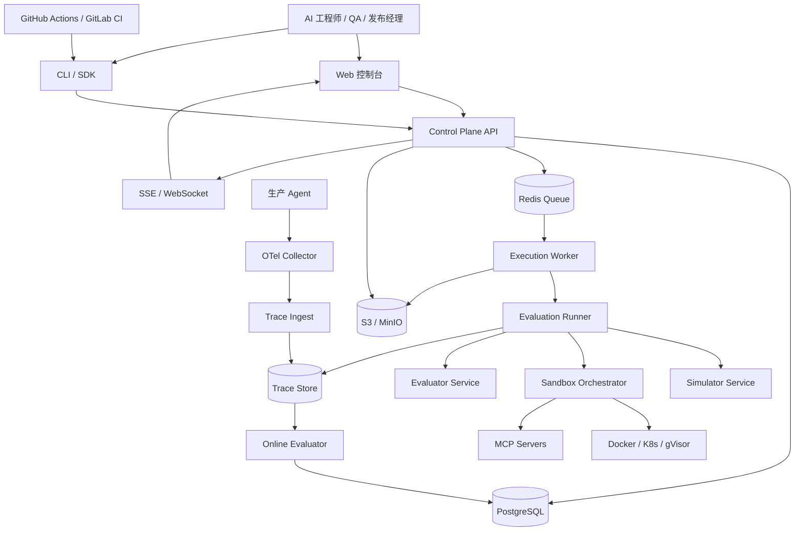
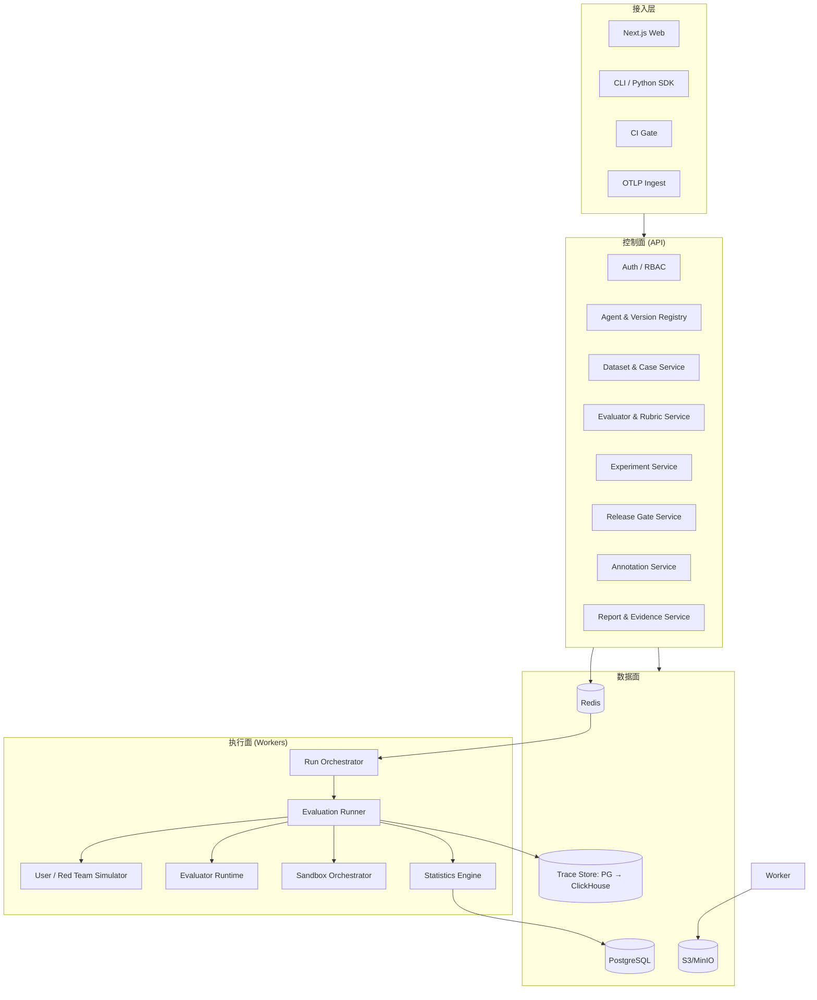
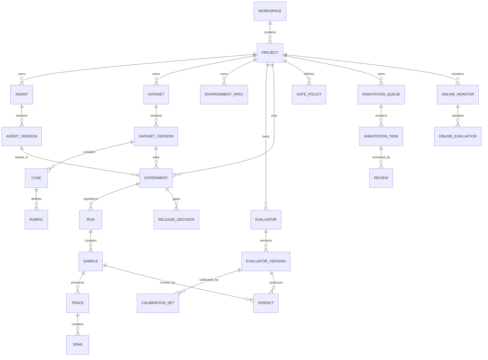
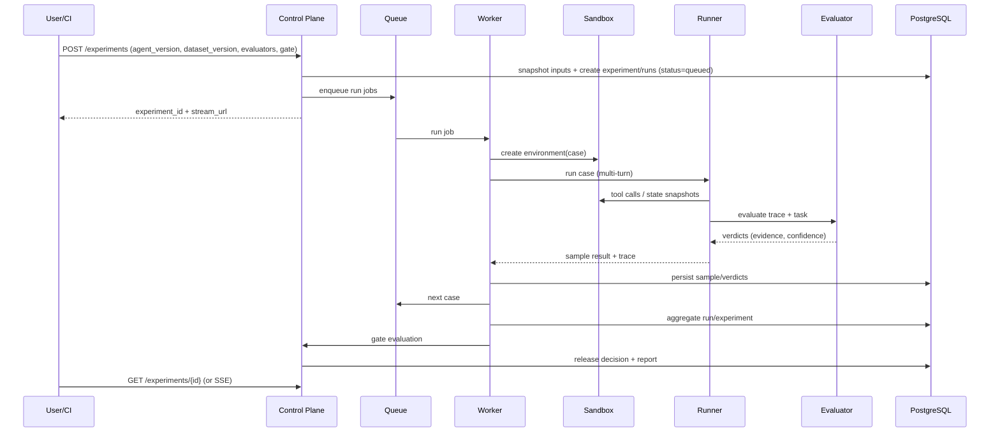
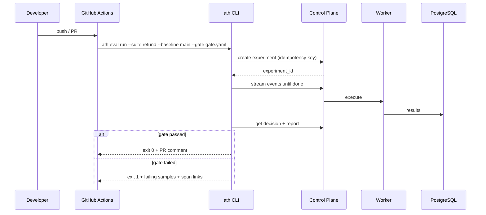
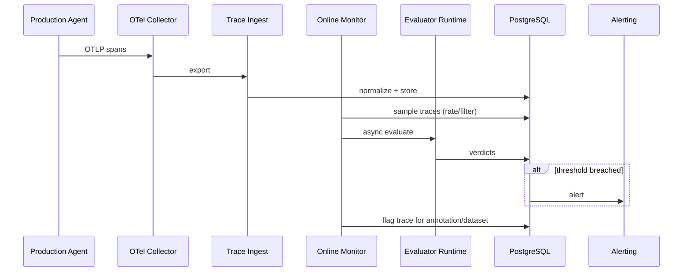
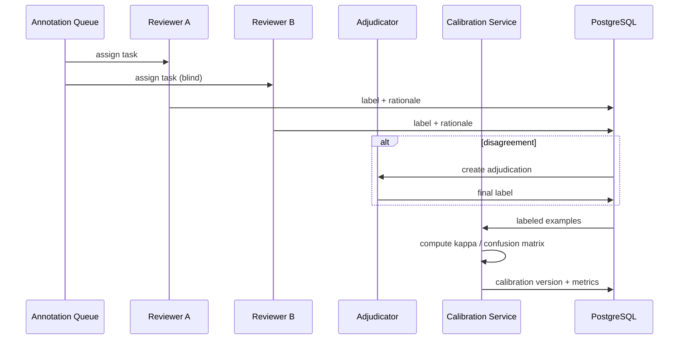

# 01 · 系统架构

> 版本：1.0  
> 更新：2026-10-17  
> 状态：有效  
> 负责人：架构组

---

## 1. 目标与非目标

### 1.1 目标

1. 支撑"Agent 发布门禁"的完整闭环：定义 → 实验 → 证据 → 门禁 → 生产回流。
2. 评测对象可插拔：单 Agent、多 Agent、MCP 工具型 Agent、Webhook、任意框架。
3. 评测环境可插拔：SQLite、PostgreSQL、Docker、MCP、浏览器、复合环境。
4. 评测方法可插拔：确定性检查、LLM Judge、Agent Judge、人工标注、混合评审团。
5. 结果可复现、可审计、可回放：版本、快照、种子、Span 证据、校准版本。
6. 可从单机 CLI 平滑扩展到多租户 SaaS / 私有化 K8s。

### 1.2 非目标

- 不做 Agent 编排运行时（不替代 LangGraph/CrewAI/AutoGen）。
- 不做模型推理服务/模型网关（LiteLLM 作为适配层，不重建）。
- 不做通用 LLM 可观测平台（通过 OTel 接入/导出，与现有平台共存）。
- 不做 Prompt CMS/Playground（可作为后续集成）。
- 不做公开榜单托管（只做私有、版本化基准）。

---

## 2. 架构原则

| 原则 | 含义 | 落地约束 |
|---|---|---|
| **Evidence-first** | 每个结论必须能指向证据 | Verdict 必须带 Span/状态差分引用；无证据 → UNKNOWN |
| **Deterministic-first** | 能确定性判断的绝不交给 LLM | 状态、工具 Schema、SQL、策略、PII 先用代码检查 |
| **OTel-first** | 不自造私有 Trace 格式 | 内部 Span 模型与 OTel GenAI 对齐；支持 OTLP 导入/导出 |
| **Reproducible** | 同配置可重放 | 版本化数据集/Prompt/工具/模型/镜像/种子；快照哈希 |
| **Open-core** | 核心可被集成，不锁定 | Runner/SDK/场景规范开源；企业治理商业版 |
| **Security by default** | 沙盒隔离、最小权限、默认脱敏 | 容器非 root、网络默认拒绝、密钥 KMS、审计日志 |
| **Modular monolith first** | 先单体模块化，后按需拆服务 | API/Worker/Runner 同仓分模块；队列解耦；不提前微服务化 |

---

## 3. 系统上下文



### 3.1 外部系统

| 系统 | 关系 | 协议 |
|---|---|---|
| 被测 Agent | 调用/被调用 | HTTP Webhook、OpenAI 兼容、框架适配器 |
| 模型供应商 | 评测模型与被测模型 | LiteLLM（OpenAI/Anthropic/Qwen/DeepSeek/本地） |
| MCP Server | 工具执行 | MCP JSON-RPC 2.0 |
| A2A Agent | 跨 Agent 协作 | A2A |
| OTel Collector | Trace 导入/导出 | OTLP/HTTP、OTLP/gRPC |
| CI | 触发实验、门禁 | REST + CLI |
| 身份提供方 | SSO | OIDC/SAML |

---

## 4. 逻辑架构



### 4.1 控制面

| 模块 | 职责 | 关键约束 |
|---|---|---|
| Auth / RBAC | 登录、SSO、工作区成员、角色、审计 | 最小权限；写操作审计 |
| Registry | Agent、AgentVersion、模型/Prompt/工具配置 | 版本不可变；内容哈希 |
| Dataset | Dataset、DatasetVersion、Case、Rubric | 版本不可变；支持导入/导出 |
| Evaluator | Evaluator、EvaluatorVersion、CalibrationSet | 评委版本化；校准版本绑定 |
| Experiment | Experiment、Run、Sample、Baseline | 幂等；快照固定输入 |
| Gate | GatePolicy、ReleaseDecision | 阈值可配置；决策可追溯 |
| Annotation | Queue、Task、Review、Adjudication | 多人复核；标签不可篡改 |
| Report | Evidence Bundle、签名报告 | 内容寻址；可回放 |

### 4.2 执行面

| 模块 | 职责 | 关键约束 |
|---|---|---|
| Run Orchestrator | 展开 repetitions × cases，调度任务 | 幂等、可取消、可重试 |
| Evaluation Runner | 单用例多轮循环、工具执行、Trace 采集 | 超时/预算/熔断 |
| Simulator | 双控用户、红队攻击、故障注入 | 状态化、可复现、策略约束 |
| Evaluator Runtime | 确定性检查、LLM/Agent Judge、人工 | 预算、缓存、证据校验 |
| Sandbox Orchestrator | 环境创建/快照/回滚/销毁 | 隔离、配额、出口控制 |
| Statistics | Wilson/Bootstrap/配对比较/Flaky | 按 case/run 分层；效应量 |

### 4.3 数据面

| 存储 | 用途 | 备注 |
|---|---|---|
| PostgreSQL | 元数据、实验、判决、标注、审计 | 事务一致性；行级 tenant_id |
| Redis | 队列、缓存、SSE 事件、限流 | 不持久化关键数据 |
| S3/MinIO | Trace 附件、报告、快照、数据集文件 | 内容哈希、生命周期策略 |
| Trace Store | Span 查询 | Phase 1 用 PG JSONB；Phase 2 引入 ClickHouse |
| OTel Collector | Trace 接收/转发 | 标准 OTLP；采样与脱敏 |

---

## 5. 核心领域模型



### 5.1 关键实体

| 实体 | 关键字段 | 说明 |
|---|---|---|
| Workspace | id, name, plan, region | 租户边界 |
| Project | id, workspace_id, name | 团队/产品边界 |
| Agent | id, project_id, name, type | 逻辑 Agent |
| AgentVersion | id, agent_id, version, config_hash, prompt, model, tools, framework | 不可变 |
| Dataset | id, project_id, name, domain | 数据集 |
| DatasetVersion | id, dataset_id, version, content_hash, case_count | 不可变 |
| Case | id, dataset_version_id, title, input, environment_spec_id, expected_state, rubric_set | 单用例 |
| EnvironmentSpec | id, project_id, kind, init_script, tools, faults, network_policy | 世界定义 |
| Evaluator | id, project_id, kind, name | 评委逻辑 |
| EvaluatorVersion | id, evaluator_id, version, config, prompt, model, calibration_id | 不可变 |
| CalibrationSet | id, project_id, name, labels, kappa, created_at | 人工标签集 |
| Experiment | id, project_id, agent_version_id, dataset_version_id, evaluator_version_ids, config, snapshot_hash, status | 一次实验 |
| Run | id, experiment_id, repetition_index, status, summary | 重复运行 |
| Sample | id, run_id, case_id, status, result | 单用例结果 |
| Trace | id, sample_id, otel_trace_id, start/end, attributes | 执行轨迹 |
| Span | id, trace_id, parent_id, kind, name, attributes, status | OTel Span |
| Verdict | id, sample_id, rubric_id, evaluator_version_id, verdict, confidence, evidence_refs, rationale | 判决 |
| GatePolicy | id, project_id, name, thresholds, fatal_rules, sample_size | 门禁规则 |
| ReleaseDecision | id, experiment_id, gate_policy_id, decision, reasons, report_id | 发布决策 |
| AnnotationTask | id, queue_id, sample_id, rubric_id, assignee, status | 标注任务 |
| Review | id, task_id, reviewer_id, label, rationale, confidence | 复核记录 |
| OnlineMonitor | id, project_id, name, sampling_rate, evaluators, alert_rules | 在线监控 |
| OnlineEvaluation | id, monitor_id, trace_id, verdicts, created_at | 在线评估 |

### 5.2 版本与不可变性

- `AgentVersion`、`DatasetVersion`、`EvaluatorVersion`、`GatePolicy` 一旦被实验引用即不可修改，只能创建新版本。
- 实验创建时对输入做**快照**（canonical JSON + SHA-256），后续任何配置变化都不影响已创建实验。
- Verdict 绑定 `evaluator_version_id` 和 `calibration_id`，保证"这个分数由哪个评委、哪版校准产出"可追溯。

---

## 6. 运行时流程

### 6.1 离线实验



### 6.2 CI 门禁



### 6.3 在线评估



### 6.4 标注与校准



---

## 7. 部署拓扑

### 7.1 本地开发

```text
docker compose:
  api (FastAPI, reload)
  worker (Arq)
  postgres
  redis
  minio
  otel-collector
  web (Next.js dev)
```

- 可选 SQLite 模式，仅用于 CLI/单测，不作为团队/生产模式。
- 沙盒默认使用本地 Docker；无 Docker 时降级为 SQLite/内存环境，但标注"降级模式"。

### 7.2 团队/私有化

```text
Kubernetes (Helm):
  web (Deployment + Service + Ingress)
  api (Deployment + HPA)
  worker (Deployment + KEDA/queue autoscaling)
  sandbox-runner (Job/Pod per case, gVisor optional)
  postgres (managed or operator)
  redis (managed or operator)
  minio (or S3)
  otel-collector (DaemonSet/Deployment)
  clickhouse (optional, Phase 2)
```

- 所有组件支持 air-gapped 镜像仓库。
- 租户隔离：共享 DB + row-level tenant_id；高敏客户可选独立 schema/DB。
- 密钥：KMS/Vault；禁止把主密钥放在数据库同目录。

### 7.3 SaaS

- 多租户共享控制面，执行面按租户池隔离；高敏租户专用 worker pool。
- 数据驻留：按 region 分库/分桶。
- 配额：并发实验数、沙盒时长、Token 预算、存储。

---

## 8. 数据架构

### 8.1 一致性

- 实验创建在一个事务里固定所有输入版本，避免"跑一半数据集变了"。
- Sample/Verdict 写入幂等（`sample_id` 唯一键），Worker 重试不重复计分。
- 聚合结果由 Worker 计算并持久化；API 只读，避免重复计算。

### 8.2 留存与删除

- Trace/报告默认留存 90 天（可配置）；企业可自定义。
- 删除数据集/实验时，级联删除附件与 Trace；审计日志保留最小元数据。
- 客户数据导出：JSONL + 证据包；支持按实验/数据集导出。

### 8.3 内容寻址

- 数据集版本、报告、证据包使用内容哈希寻址。
- 报告包含 manifest：代码版本、镜像 digest、模型版本、Prompt 哈希、工具 Schema 哈希、种子、评委/校准版本。

---

## 9. 集成架构

### 9.1 被测 Agent 接入

| 方式 | 适用 | 说明 |
|---|---|---|
| Webhook | 任意 HTTP Agent | 请求含 prompt/task/tools；响应含 response/tool_calls |
| OpenAI 兼容 | 模型型 Agent | LiteLLM 适配 |
| 框架适配器 | LangGraph/CrewAI/AutoGen/OpenAI Agents SDK/smolagents | 拦截 Tool 调用与 Trace |
| OTel 导入 | 已在生产埋点的 Agent | 直接导入 trace，离线回放/评估 |
| MCP | 工具型 Agent | MCP Proxy 记录 tools/list、tools/call |
| A2A | 跨 Agent | 记录 agent card、task、message |

### 9.2 标准

- **OTel GenAI**：Span 类型 agent/llm/tool/retriever/guardrail；属性对齐官方约定。
- **OpenInference**：兼容导入。
- **MCP 2025-06-18**：tools/resources/prompts；安全同意与工具描述不可信原则。
- **A2A**：Agent Card、Task 生命周期、消息。
- **OpenAPI 3.1**：控制面 API；生成 SDK。

### 9.3 导出

- OTLP 导出到客户现有 APM（Datadog/New Relic/Grafana Tempo）。
- Webhook 事件：experiment.completed、gate.failed、annotation.created。
- 报告导出：HTML（自包含）、JSON、JUnit XML（CI）。

---

## 10. 安全架构

| 层 | 措施 |
|---|---|
| 身份 | OIDC/SAML SSO、SCIM、MFA（企业版） |
| 授权 | Workspace/Project RBAC：owner/admin/engineer/viewer；API Token scope |
| 租户 | row-level tenant_id + 查询强制过滤；对象存储前缀隔离；可选独立 DB |
| 密钥 | KMS/Vault envelope encryption；启动注入；不落盘；轮换 |
| 数据 | 入站脱敏（API Key/PII）、传输 TLS、静态加密、留存策略 |
| 沙盒 | 非 root、只读 rootfs、无特权、seccomp、网络默认拒绝、出口白名单、CPU/内存/磁盘/时间配额 |
| 供应链 | 镜像签名、SBOM、依赖锁定、漏洞扫描 |
| 审计 | 登录、配置变更、实验创建、门禁决策、数据导出 |
| 合规 | SOC2/ISO27001 路线图；等保/信创适配；DPA |

### 10.1 红队安全边界

- 只允许在隔离沙盒内执行攻击载荷。
- 禁止真实世界攻击、凭据窃取、生产系统破坏。
- 红队运行需要显式授权与范围声明（rules of engagement）。
- 攻击输出脱敏，不存储真实密钥。

---

## 11. 可靠性与扩展性

### 11.1 SLO

| 指标 | 目标 |
|---|---|
| API 可用性 | 99.9%（企业版） |
| API p95 延迟 | < 300 ms（读）/ < 800 ms（写） |
| 实验排队延迟 | p95 < 30 s |
| 实验成功率 | > 99%（排除被测 Agent 错误） |
| 沙盒启动 | p95 < 10 s（预热池） |
| Trace 摄入延迟 | p95 < 60 s |

### 11.2 扩展

- Worker 无状态，按队列深度水平扩展。
- 沙盒使用预热池 + 每用例容器；大规模用 K8s Job。
- Trace 存储 Phase 1 用 PG 分区；Phase 2 迁移 ClickHouse。
- 读模型缓存（实验列表/报告）用 Redis；失效由事件驱动。

### 11.3 容错

- 任务幂等键 = experiment_id + case_id + repetition。
- Worker 崩溃：任务重新入队；已完成的 sample 不重复执行。
- 被测 Agent 超时/异常：标记 `execution_error`，计为失败但区分"平台错误"与"Agent 错误"。
- 评委失败：UNKNOWN + 人工复核，不静默通过。
- 沙盒泄漏：定期回收 + 租约超时。

---

## 12. 架构决策记录（ADR）

| ID | 决策 | 理由 | 替代方案 | 状态 |
|---|---|---|---|---|
| ADR-001 | 模块化单体 + 独立 Worker | 早期团队小，降低运维成本；队列天然解耦 | 微服务 | 接受 |
| ADR-002 | PostgreSQL 作为主存储 | 事务、JSONB、成熟运维 | SQLite（仅本地）、MySQL | 接受 |
| ADR-003 | OTel GenAI 作为 Trace 标准 | 生态兼容，避免锁定 | 私有格式 | 接受 |
| ADR-004 | 确定性检查优先，LLM Judge 兜底 | 可信、低成本 | LLM-only | 接受 |
| ADR-005 | Docker 作为默认沙盒隔离 | 成本/生态平衡 | Firecracker/gVisor 默认 | 接受（高敏可选 gVisor） |
| ADR-006 | Next.js + React 保留 | 现有 UI 资产；生态成熟 | 重写为其他框架 | 接受 |
| ADR-007 | Open-core（Apache 2.0 核心） | 分发与信任 | 闭源 | 待法务确认 |
| ADR-008 | Phase 1 不引入 ClickHouse | 降低复杂度；PG JSONB 足够 | 一开始 ClickHouse | 接受（Phase 2 复审） |

---

## 13. 从现状迁移

### 13.1 保留

- `packages/core` 的领域 schema、Runner 主循环、LLM Judge/模拟器思路。
- `packages/sandbox` 的 SQLite 环境与故障注入接口。
- `packages/server` 的工作区/资产/实验 API 形态。
- `apps/web` 的页面骨架与 Trace 查看器。
- `benchmarks/` 场景资产。
- `tests/` 现有回归测试。

### 13.2 重构

| 现状 | 目标 |
|---|---|
| `runner.py` 内嵌评分/安全检查 | 拆为 `engine/` + `evaluators/` + `policies/` |
| 关键词 Judge | 确定性检查 + 校准 LLM Judge |
| 单文件 server/app.py | 按领域拆 router/service/repository |
| 原生 sqlite3 | SQLAlchemy 2 + Alembic + Postgres |
| 进程内事件流 | Redis pub/sub + SSE |
| 同步长请求 | 队列 + Worker |
| 模拟 Docker/MCP | 真实 Docker/MCP 客户端 |
| 未接线的 metrics | 接入 Runner 或标记实验性 |
| 旧设计文档 | 删除，统一到 `docs/` |

### 13.3 迁移步骤

1. 新建 `packages/domain`（实体/值对象）与 `packages/engine`（Runner/Evaluator/Environment 接口）。
2. 用适配器包装现有 Runner，保持 API 兼容；逐步替换内部实现。
3. 引入 Postgres + Alembic；提供 SQLite → Postgres 迁移脚本。
4. 引入 Redis + Arq；把 universal-run 改为异步任务。
5. 前端切换到 OpenAPI 生成的类型客户端；保留页面结构。
6. 删除旧文档与死代码；更新 README。

---

## 14. 架构验收清单

- [ ] 所有 Verdict 都能追溯到 Span/状态差分。
- [ ] 同一实验重复运行，确定性检查结果完全一致。
- [ ] 实验输入有快照哈希，配置变更不影响历史实验。
- [ ] 沙盒默认无网络、非 root、有资源配额。
- [ ] OTel Trace 可导入/导出，字段对齐 GenAI 语义约定。
- [ ] API 幂等、可取消、可分页、有审计。
- [ ] 租户数据隔离有自动化测试。
- [ ] 报告可在无平台环境下离线打开并验证签名。
